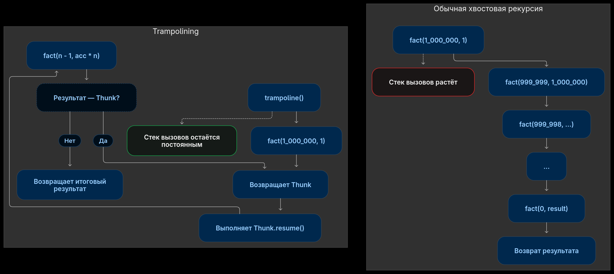

# Trampoline: recursion of any depth in PHP



In functional languages, unlike PHP and other mainstream languages, there are no loops. Recursion takes their place.
But in that same PHP the depth of a recursive call is limited, and, well, most of the time that doesn't matter,
you just write it with iteration.
But my [lisp interpreter](https://github.com/4irik/lisphp) is written in PHP, which means
if I want it to actually work, it has to handle recursive calls of any nesting depth.

Let's start by looking at what PHP gives us:

```php
function show(string $label): void
{
    echo $label . "\n";
    foreach (debug_backtrace(DEBUG_BACKTRACE_IGNORE_ARGS) as $i => $frame) {
        $fn = $frame['function'] ?? '?';
        $line = $frame['line'] ?? '-';
        echo "  #$i $fn line $line\n";
    }
}

function fact_rec(int $n): int {
    if ($n === 0) {
        show('fact rec at n=0');
        return 1;
    }

    return fact_rec($n - 1) * $n;
}

function fact_iter(int $n, int|float $acc = 1): int|float {
    if ($n === 0) {
        show('fact iter at n = 0');
        return $acc;
    }

    return fact_iter($n - 1, $acc * $n);
}

fact_rec(10);
fact_iter(10);
```

When you run it, the call stack piles up in both the recursive and the iterative form of the function:

```out
fact rec at n=0
  #0 show line 63
  #1 fact_rec line 67
  #2 fact_rec line 67
  #3 fact_rec line 67
  #4 fact_rec line 67
  #5 fact_rec line 67
  #6 fact_rec line 67
  #7 fact_rec line 67
  #8 fact_rec line 67
  #9 fact_rec line 67
  #10 fact_rec line 67
  #11 fact_rec line 79
fact iter at n = 0
  #0 show line 72
  #1 fact_iter line 76
  #2 fact_iter line 76
  #3 fact_iter line 76
  #4 fact_iter line 76
  #5 fact_iter line 76
  #6 fact_iter line 76
  #7 fact_iter line 76
  #8 fact_iter line 76
  #9 fact_iter line 76
  #10 fact_iter line 76
  #11 fact_iter line 80
```

And, with a large enough initial input, we get Allowed memory size.
For the recursive version I ran out of memory computing the factorial of 185_000,
for the iterative form — 220_000.

So there is a way to make languages without [TCO](https://en.wikipedia.org/wiki/Tail_call)
clear the call stack when it is no longer needed. It's called a _trampoline_.
Unfortunately, it requires changes to the original function:

1. you need to rewrite it into iterative form (fact_iter is the example) so that each call is independent and receives, as arguments, everything it needs to compute;
2. the function must return not a call to itself, but a special container that holds that self-call.

```php
final class Thunk
{
    public function __construct(public Closure $resume) {}
}

function trampoline(Closure $start): mixed
{
    $value = $start();
    while ($value instanceof Thunk) {
        $value = ($value->resume)();
    }
    return $value;
}

function fact_trump(int $n, int|float $acc = 1): Thunk|int|float {
    if ($n === 0) {
        show('fact trump at n = 0');
        return $acc;
    }

    return new Thunk(static fn() => fact_trump($n - 1, $acc * $n));
}

trampoline(static fn() => fact_trump(1_000_000));
```

And we see this stack trace:

```out
fact trump at n = 0
  #0 show line 81
  #1 fact_trump line 85
  #2 {closure:fact_trump():85} line 13
  #3 trampoline line 90
```

that's for the factorial of a million! A reminder that the two previous implementations already OOM'd around 200_000.

PS. `int|float` in the iterative form is there because on large numbers we overflow `int`
and the interpreter turns the number into a `float`.

PPS. The full code example - https://gist.github.com/4irik/83732a02ea7b6c0b85bf40ab0619aab1
