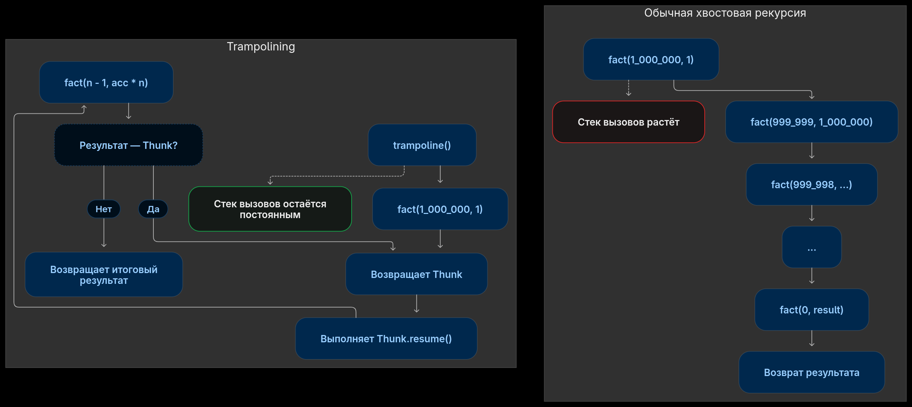

# Трамплин: рекурсия любой глубины в PHP



В функциональных языках, в отличие от PHP и прочих мейнстримных языков, нет циклов, их место занимает рекурсия.
Но в том же самом PHP глубина рекурсивного вызова ограничена, ну и как бы, в большинстве случаев, это не важно,
просто пишем через итерации.
Но мой [lisp-интерпретатор](https://github.com/4irik/lisphp) написан на PHP, а значит,
если я хочу чтобы он полноценно работал, нужно чтобы он обрабатывал рекурсивные вызовы любой вложенности.

Начнём с анализа того что есть в PHP:

```php
function show(string $label): void
{
    echo $label . "\n";
    foreach (debug_backtrace(DEBUG_BACKTRACE_IGNORE_ARGS) as $i => $frame) {
        $fn = $frame['function'] ?? '?';
        $line = $frame['line'] ?? '-';
        echo "  #$i $fn line $line\n";
    }
}

function fact_rec(int $n): int {
    if ($n === 0) {
        show('fact rec at n=0');
        return 1;
    }

    return fact_rec($n - 1) * $n;
}

function fact_iter(int $n, int|float $acc = 1): int|float {
    if ($n === 0) {
        show('fact iter at n = 0');
        return $acc;
    }

    return fact_iter($n - 1, $acc * $n);
}

fact_rec(10);
fact_iter(10);
```

При запуске мы увидим что стек вызовов будет копиться и в рекурсивной и в итеративной форме функции:

```out
fact rec at n=0
  #0 show line 63
  #1 fact_rec line 67
  #2 fact_rec line 67
  #3 fact_rec line 67
  #4 fact_rec line 67
  #5 fact_rec line 67
  #6 fact_rec line 67
  #7 fact_rec line 67
  #8 fact_rec line 67
  #9 fact_rec line 67
  #10 fact_rec line 67
  #11 fact_rec line 79
fact iter at n = 0
  #0 show line 72
  #1 fact_iter line 76
  #2 fact_iter line 76
  #3 fact_iter line 76
  #4 fact_iter line 76
  #5 fact_iter line 76
  #6 fact_iter line 76
  #7 fact_iter line 76
  #8 fact_iter line 76
  #9 fact_iter line 76
  #10 fact_iter line 76
  #11 fact_iter line 80
```

И, при достаточно большом начальном входном значении, мы получаем Allowed memory size.
Для рекурсивной версии функции я получил выход за пределы памяти при вычислении факториала от 185_000,
для итеративной формы — 220_000.

Так вот, есть способ заставить языки без [TCO](https://en.wikipedia.org/wiki/Tail_call),
подчищать стек вызовов, если он не нужен. Называется _трамплин_.
Но, к сожалению, он требует модификаций исходной функции:

1. нужно перевести форму в итеративную форму (пример — fact_iter) чтобы каждый вызов был независим и получал, в качестве аргументов, все необходимые данные для вычисления;
2. функция должна вернуть не вызов себя же, а специальный контейнер в котором заключён этот самовызов.

```php
final class Thunk
{
    public function __construct(public Closure $resume) {}
}

function trampoline(Closure $start): mixed
{
    $value = $start();
    while ($value instanceof Thunk) {
        $value = ($value->resume)();
    }
    return $value;
}

function fact_trump(int $n, int|float $acc = 1): Thunk|int|float {
    if ($n === 0) {
        show('fact trump at n = 0');
        return $acc;
    }

    return new Thunk(static fn() => fact_trump($n - 1, $acc * $n));
}

trampoline(static fn() => fact_trump(1_000_000));
```

И, видим такой вывод стека:

```out
fact trump at n = 0
  #0 show line 81
  #1 fact_trump line 85
  #2 {closure:fact_trump():85} line 13
  #3 trampoline line 90
```

это для факториала миллионного числа! Напоминаю что две предыдущих реализации получили OOM уже в районе 200_000.

PS. `int|float` в итеративной форме функции указано т.к. на больших числах мы выходим за пределы `int`
и интерпретатор преобразует число во `float`.

PPS. Полный пример кода - https://gist.github.com/4irik/83732a02ea7b6c0b85bf40ab0619aab1
